<div align="center">

# PocketFlow

**The co-pilot for your wallet.**

A local-first budgeting app built around one question:
*what can I safely spend today without hurting tomorrow?*

[](https://getpocketflow.vercel.app/)

[](https://nextjs.org/)
[](https://www.typescriptlang.org/)
[](https://tailwindcss.com/)
[](https://zustand-demo.pmnd.rs/)
[](https://ai.google.dev/)
[](LICENSE)
[](https://vitest.dev/)

</div>

---

## Table of contents

- [Screenshots](#screenshots)
- [Try it](#try-it)
- [Why PocketFlow](#why-pocketflow)
- [Features](#features)
- [Architecture](#architecture)
- [How the budget engine works](#how-the-budget-engine-works)
- [AI co-pilot](#ai-co-pilot)
- [Privacy and data](#privacy-and-data)
- [Tech stack](#tech-stack)
- [Getting started](#getting-started)
- [Scripts](#scripts)
- [Project structure](#project-structure)
- [Testing](#testing)
- [Deployment](#deployment)
- [Known limitations](#known-limitations)
- [Roadmap](#roadmap)
- [FAQ](#faq)
- [Contributing](#contributing)
- [License](#license)

---

## Screenshots

<p align="center">
  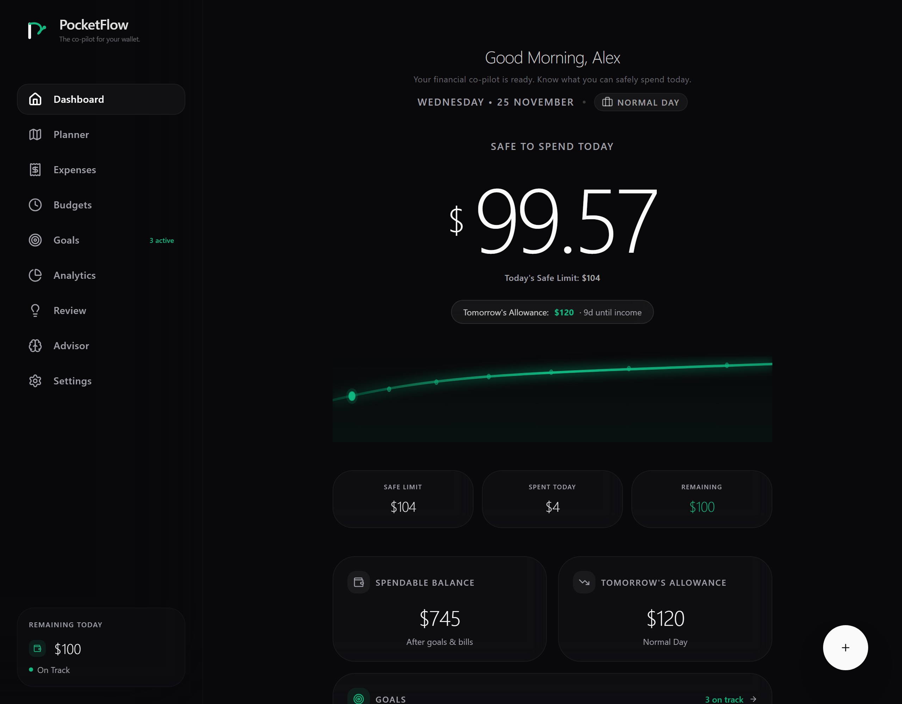
</p>

<p align="center">
  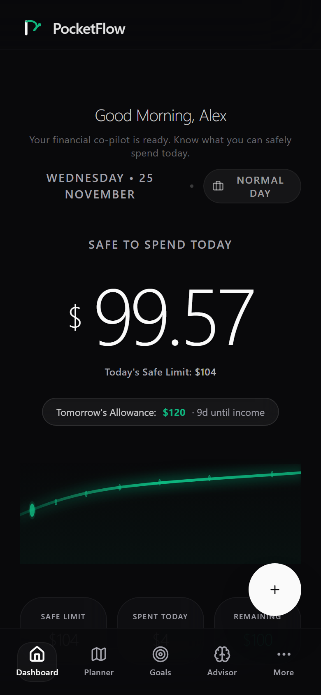
  &nbsp;
  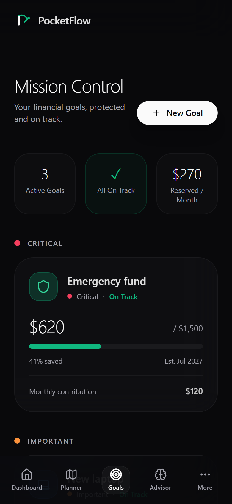
</p>

<table>
  <tr>
    <td>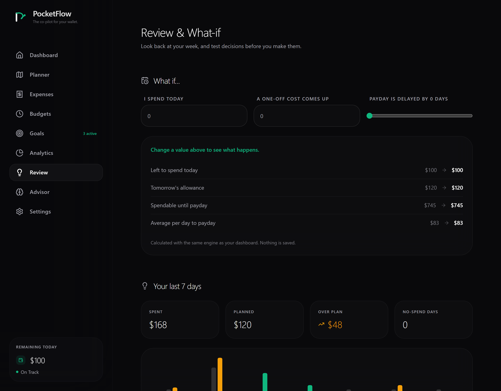</td>
    <td>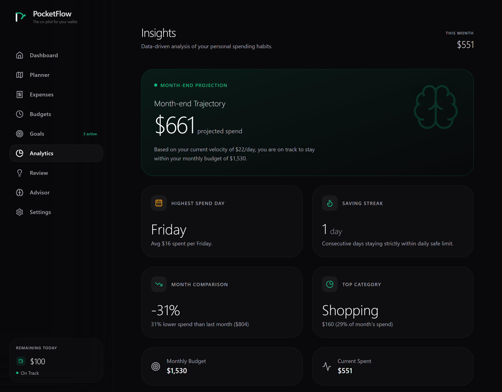</td>
  </tr>
  <tr>
    <td align="center"><sub>What-if simulator and weekly review</sub></td>
    <td align="center"><sub>Spending insights</sub></td>
  </tr>
  <tr>
    <td colspan="2">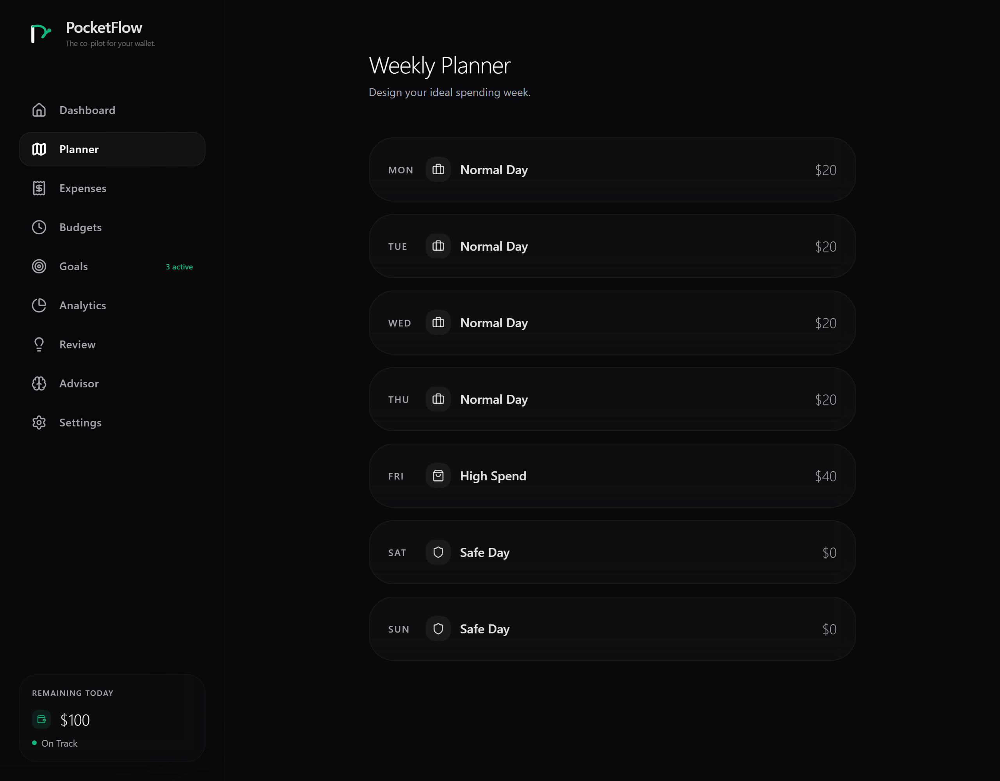</td>
  </tr>
  <tr>
    <td colspan="2" align="center"><sub>Weekly planner</sub></td>
  </tr>
</table>

All screenshots use the built-in sample data (see [Try it](#try-it)).

---

## Try it

- **Live demo:** [getpocketflow.vercel.app](https://getpocketflow.vercel.app/). Tap **Explore with sample data** on the welcome screen to look around without entering anything. A banner lets you wipe the sample data and start fresh.
- **Install on your phone:** PocketFlow is a PWA.
  - **Android (Chrome):** menu (⋮) → **Install app**.
  - **iPhone (Safari):** Share → **Add to Home Screen**.
  - Updates arrive on their own the next time you open the app online. Your data is not affected.

---

## Why PocketFlow

Most budgeting apps look backward and tell you where your money *went*. PocketFlow looks forward.

It treats your balance as something to allocate, not a pool to drain. Before it gives you a daily number, it sets aside money for upcoming bills and the goals you want to protect. What remains is spread across the days until your next payday, weighted by how much you expect to spend on each kind of day.

The result is one number you can act on: **today's safe limit**.

---

## Features

### Plan
- **Day profiles**: define kinds of days (Safe, Low, Normal, High, or your own) with an expected spend each.
- **Weekly planner**: map a profile to every day of the week. Safe days get a zero limit, so the money goes to the days that need it.
- **Recurring bills**: daily, weekly, monthly and semester bills. Every occurrence due before payday is reserved, and an overdue bill is reserved once.
- **Payday handling**: automatic or manual income, credited once per payday so it can never double-count.

### Protect
- **Goals with priority**: Critical, Important, Planned and Nice-to-have goals are funded in that order when money is tight.
- **Category budgets**: optional monthly limits per category, with warnings at 80% and when exceeded.

### Decide
- **Today's safe limit and tomorrow's allowance**, recalculated live as you log spending and refreshed when the day rolls over.
- **What-if simulator** (`/review`): see how extra spending, a one-off cost or a delayed payday changes today and tomorrow before you commit.
- **AI advisor** (`/advisor`): ask plain-language questions and get a verdict, key numbers and one recommendation.

### Track and understand
- **Fast entry**: type `500 lunch`, `rs 1.5k uber` or `yesterday 200 chai`. The amount, category and date are parsed for you.
- **Expenses and income**: log both, edit or delete either, and **undo** any change from the snackbar.
- **Favorites**: save repeat expenses for one-tap logging.
- **Weekly review**: planned vs. actual spend, over-budget days, top category, and suggestions for profiles that are consistently over- or under-estimated. Only days after your first logged expense count.
- **Analytics**: daily averages, category breakdowns, trends and a saving streak.
- **Ledger-based balance**: balance is always `opening balance + income − expenses`, so deleting an expense returns the money and the numbers always reconcile.
- **CSV export** of your expenses.

### Everywhere
- **13 currencies** with the right symbol and grouping.
- **Installable PWA** with an offline-capable service worker (production builds).
- **Local reminders** for bills and daily logging, through the browser Notification API.
- **PIN lock**: an app lock for casual privacy (see [Privacy and data](#privacy-and-data)).
- **Sample-data demo mode** so anyone can explore the app instantly.
- **Accessibility**: visible keyboard focus, labelled controls and tap-friendly chart tooltips.
- **Light and dark themes**, responsive from phone to desktop.

---

## Architecture

PocketFlow is a client-side app. The browser holds all state and does all the math. The server exists for one job only: proxying the AI advisor so the API key stays secret.

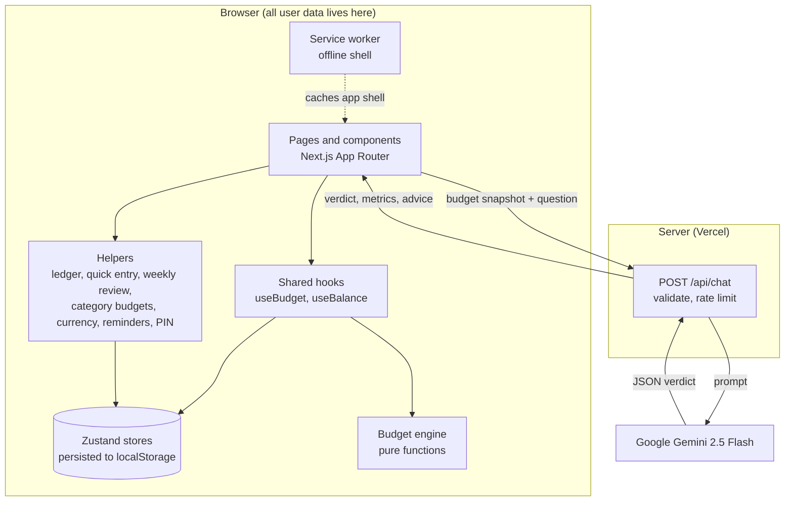

### Layers

| Layer | Responsibility | Where |
| --- | --- | --- |
| Presentation | Pages, forms, charts, animations | `src/app`, `src/components` |
| Hooks | Read stores reactively, feed the engine, refresh at midnight | `src/store/useBudget.ts`, `useBalance.ts` |
| Domain logic | Pure, deterministic, unit tested | `src/lib/*` |
| State | Versioned, persisted slices | `src/store/*` |
| Server | AI proxy with validation and rate limiting | `src/app/api/chat` |

Domain logic never touches the DOM, the stores or the clock directly, which is why it's easy to test.

### Data flow for a single expense

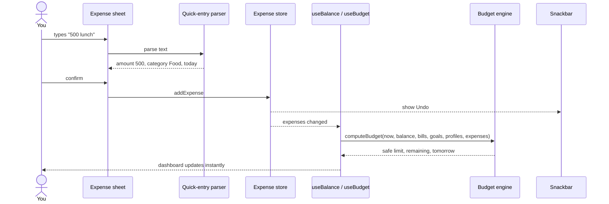

### Data model

Balance is never stored. It is derived from the ledger, so it can't drift out of sync.

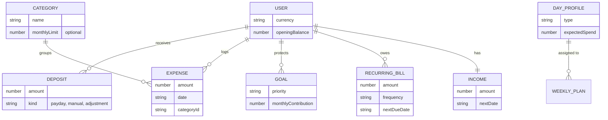

`balance = openingBalance + sum(deposits) - sum(expenses)`

### Persistence and migrations

Each store is persisted under its own `localStorage` key with a schema version. When a shape changes, a migration upgrades old data on load (for example, the user store's v3 to v4 migration converted a stored balance into an opening balance plus a ledger). Payday credits use deterministic ids (`payday-YYYY-MM-DD`), so they can never be applied twice.

---

## How the budget engine works

All the math lives in one pure, dependency-free module, [`src/lib/budgetEngine.ts`](src/lib/budgetEngine.ts). The dashboard, sidebar, trajectory graphic, what-if simulator and AI context all call the same functions, so they cannot disagree.

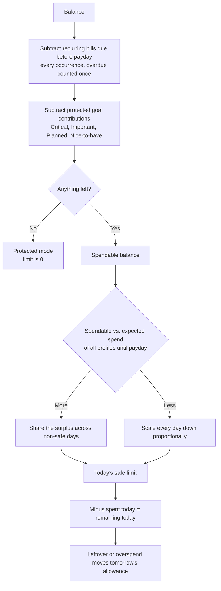

How it distributes money:

- If spendable money exceeds what your profiles expect, the surplus is shared across the non-safe days.
- If it falls short, every day's expectation is scaled down proportionally.
- If bills and goals consume the whole balance, the engine enters *protected mode* and the limit is zero.
- Dates are handled as local calendar days, so results don't shift with timezone.

`computeBudget` takes the current time as an input rather than reading the clock, which makes the engine fully deterministic and easy to test. `simulateScenario` reuses it to answer what-if questions without mutating anything.

---

## AI co-pilot

The advisor follows one rule: **decision first, explanation second.**

It does not do the math. The engine computes every figure, and the model only interprets that snapshot and returns structured JSON (verdict, metrics, recommendation, optional context).

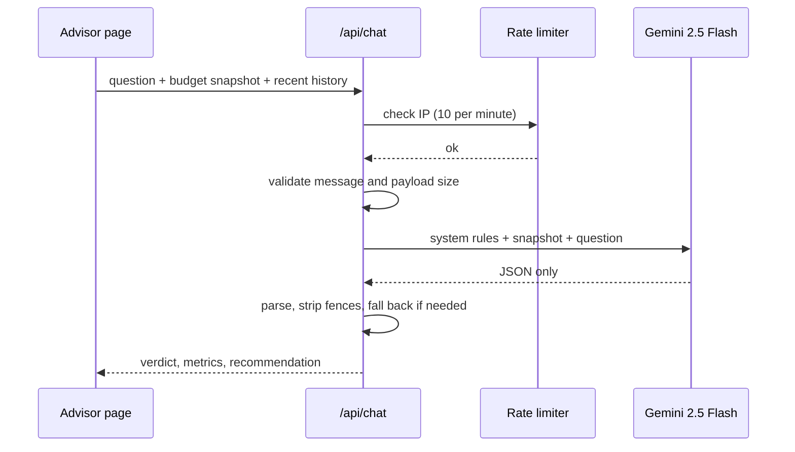

- The model is instructed to use only the numbers in the snapshot and to say so when information is missing.
- The API key stays on the server and is never sent to the browser.
- Requests are validated (message length, payload size) and rate limited to 10 requests per minute per IP.
- Upstream quota or overload errors return a clear "try again in a minute" message.
- The app works fully without a key. Only the advisor needs one.

Example questions: *"Can I spend 500 today?"*, *"What if my salary is delayed by 5 days?"*, *"How do my bills affect my daily budget?"*

---

## Privacy and data

PocketFlow has **no backend and no accounts**. Your data lives in your browser's `localStorage` and never leaves your device.

The one exception is the AI advisor. When you ask a question, a snapshot of your budget (balances, limits, bills, goals, recent expenses) is sent through the app's server route to Google's Gemini API. If that's not acceptable, don't use the advisor.

Be aware of the trade-offs of local-first storage:

- Data is per browser and per device. There is no sync between phone and laptop.
- Clearing site data erases it.
- The **PIN lock is an app lock, not encryption.** It stops someone casually opening the app on your unlocked device, but the data in `localStorage` is not encrypted.

---

## Tech stack

| Area | Choice |
| --- | --- |
| Framework | Next.js 14 (App Router), React 18, TypeScript |
| Styling | Tailwind CSS 3, shadcn-style components on Base UI, Framer Motion |
| State | Zustand 5 with `persist` (versioned migrations) |
| Dates | date-fns 4 |
| AI | Google Gemini 2.5 Flash via `@google/genai` |
| Testing | Vitest |
| PWA | Web App Manifest and a hand-written service worker |

---

## Getting started

**Requirements:** Node.js 18.17 or newer and npm.

```bash
git clone https://github.com/rauf17/pocketflow.git
cd pocketflow
npm install
```

Optional: enable the AI advisor by creating `.env.local` (see [`.env.example`](.env.example)):

```env
GEMINI_API_KEY=your_gemini_api_key_here
```

You can get a key from [Google AI Studio](https://aistudio.google.com/). Then start the app:

```bash
npm run dev
```

Open <http://localhost:3000>. The welcome wizard asks for your currency, balance, payday and weekly plan.

---

## Scripts

| Command | What it does |
| --- | --- |
| `npm run dev` | Start the development server |
| `npm run build` | Create a production build |
| `npm start` | Serve the production build |
| `npm run lint` | Run ESLint |
| `npm run typecheck` | Run the TypeScript compiler without emitting |
| `npm test` | Run the unit tests once |

---

## Project structure

```
src/
├── app/
│   ├── (onboarding)/welcome/   # Setup wizard
│   ├── (app)/                  # Authenticated shell
│   │   ├── dashboard/          # Today's limit and at-a-glance
│   │   ├── expenses/           # Log, search, edit, income
│   │   ├── planner/            # Day profiles and weekly plan
│   │   ├── budgets/            # Recurring bills and category limits
│   │   ├── goals/              # Goals and priorities
│   │   ├── review/             # What-if simulator and weekly review
│   │   ├── analytics/          # Charts and trends
│   │   ├── advisor/            # AI co-pilot
│   │   └── settings/           # Currency, balance, reminders, PIN
│   ├── api/chat/               # Server route for Gemini
│   ├── demo/                   # Loads sample data
│   ├── opengraph-image.tsx     # Generated link-preview image
│   └── manifest.ts             # PWA manifest
├── components/                 # UI, expense sheet, lock screen, snackbar, reminders
├── lib/
│   ├── budgetEngine.ts         # Pure budget math
│   ├── ledger.ts               # Balance from deposits and expenses
│   ├── quickEntry.ts           # "500 lunch" parser
│   ├── weeklyReview.ts         # Weekly review and suggestions
│   ├── categoryBudgets.ts      # Category limits and warnings
│   ├── currency.ts             # Currencies and formatting
│   ├── reminders.ts, pin.ts    # Reminders and PIN hashing
│   ├── rateLimit.ts            # API rate limiter
│   └── __tests__/              # Vitest suites
├── store/                      # Zustand stores and shared hooks
public/                         # Service worker and icons
docs/                           # README screenshots and share image
```

---

## Testing

```bash
npm test          # unit tests
npm run typecheck # types
npm run lint      # lint
npm run build     # production build
```

The suite covers the budget engine (surplus, shortfall, protected mode, overdue and recurring bills, what-if scenarios), the ledger, the quick-entry parser, the weekly review, currency formatting, timezone-safe date helpers and the store migration. The engine tests inject a fixed date, so they never depend on the real clock.

---

## Deployment

PocketFlow deploys to [Vercel](https://vercel.com/) without extra configuration. Import the repository and set `GEMINI_API_KEY` in the project's environment variables. The service worker registers only in production builds.

---

## Known limitations

- **No cross-device sync.** Without a backend, each browser holds its own data.
- **No backup or import.** Data export is limited to expenses as CSV.
- **Rate limiting is best effort.** The in-memory limiter is per serverless instance, so it resets on cold starts and isn't shared across instances.
- **PIN lock is not encryption.** See [Privacy and data](#privacy-and-data).
- **Reminders need the browser.** They are local notifications, so they fire only while the browser can run the app.

---

## Roadmap

Ideas under consideration, not promises:

- [ ] Optional encrypted backup and import
- [ ] Cross-device sync without accounts
- [ ] Automatic logging of recurring daily costs
- [ ] Localization beyond currency formatting

---

## FAQ

**Can I use it on my phone and laptop at the same time?**
Each device keeps its own data. Without a backend there is nothing to sync, so use one primary device.

**Where is my data stored?**
In your browser's `localStorage`. Clearing site data erases it.

**Do I need a Gemini key?**
No. Everything works without one except the AI advisor.

**Why does the daily number change when I log an expense?**
Spending today lowers what's left for the days until payday, so the engine recalculates tomorrow's allowance immediately.

**Is the PIN lock secure?**
It's an app lock for casual privacy. It does not encrypt your data.

---

## Contributing

Issues and pull requests are welcome. Before opening a PR, please run:

```bash
npm run typecheck && npm run lint && npm test
```

Keep budget math inside `src/lib/budgetEngine.ts` so every screen continues to share one source of truth, and add a test for any behavior you change.

---

## License

Released under the [MIT License](LICENSE).
